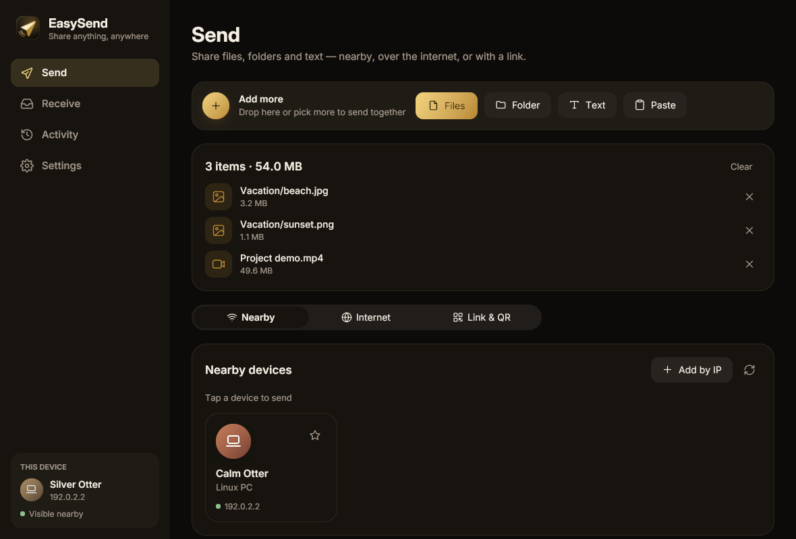

# EasySend

Send files, folders and text between any devices — nearby, across the internet, or to
someone who doesn't have the app. Built in Go with [Giode](https://github.com/xmhrnx/giode)
for Windows, macOS, Linux, Android and iOS.



## Three ways to send

| | How it works | Talks to |
| --- | --- | --- |
| **Nearby** | Devices on the same network find each other automatically (multicast + subnet scan, or add by IP). Transfers go directly over HTTPS. | Other EasySend devices **and the LocalSend apps** (LocalSend protocol v2) |
| **Internet** | Create a short code like `7-crossover-clockwork`. The other side types it in; devices connect peer-to-peer, through a relay only when they can't. End-to-end encrypted (SPAKE2). | Other EasySend devices **and every Magic Wormhole client** (`wormhole` CLI, Warp, Wormhole for Android, …) |
| **Link & QR** | A link and QR code anyone opens in a browser to download — no app needed. Optional expiry, download limit and PIN. With UPnP on (or your own public URL / tunnel), links work from the internet too. | Any browser |

Receiving works the same way in reverse: accept nearby requests (or auto-accept from
favorites), type a wormhole code, or turn on **Receive from a browser** and let people
scan a QR code to upload files and messages from their phone's browser.

## Features

- Drag and drop, folders (structure kept), text notes and clipboard text
- Accept/decline dialog, favorites, auto-accept, receive PIN
- Live progress with speed and time left; cancel anytime; full history
- "Show in folder" for received files; one-tap copy for received text
- Tray icon with quick actions, minimize/close to tray, **start at login** (opens quietly
  in the tray), always-start-hidden option
- "Send with EasySend" in the file manager's right-click menu; files opened with the app
  are added to the selection; single instance
- System notifications; keeps transfers alive in the background on phones
- Warm dark theme with gold accents (plus light and system modes) and five metallic accents (gold, rose gold, amber, champagne, bronze); adaptive layout (sidebar on desktop,
  tab bar on phones)
- Separate profiles with `EASYSEND_PROFILE=name` (run several copies side by side)

## Build and run

Needs Go 1.26+ and the [Giode CLI](https://github.com/xmhrnx/giode-cli):

```bash
go install github.com/xmhrnx/giode-cli/cmd/giode@latest
```

```bash
giode run                    # run on this computer
```

```bash
giode build linux windows    # dist/linux, dist/windows
```

```bash
giode build android          # needs the Android SDK/NDK (giode doctor)
```

```bash
giode build macos dmg ios    # on a Mac with Xcode
```

```bash
go test ./...
```

## Layout

```
main.go              wiring: window, tray, single instance, services
internal/item        what gets sent; safe paths for received names
internal/localsend   LocalSend v2: discovery, HTTPS server, client
internal/wormhole    Magic Wormhole send/receive (files, folders, text)
internal/webshare    browser download/upload pages, PIN, expiry
internal/natmap      UPnP IGD port mapping for public browser links
internal/transfer    transfer tracking and history
internal/settings    preferences
internal/engine      runs the services, exposes state to the UI
ui/                  Giode interface, one component per file
assets/              icon (SVG sources + PNGs), Android icon layers, Inter font
```

## Security notes

- Nearby transfers use HTTPS with a per-device self-signed certificate, as LocalSend does.
- Internet transfers are end-to-end encrypted by the Magic Wormhole protocol; relays
  never see the content.
- Browser links are plain HTTP (browsers would warn on a self-signed certificate). Links
  carry an unguessable token; add a PIN and an expiry for anything sensitive, especially
  when they're reachable from the internet. For public links over HTTPS, put EasySend
  behind your own domain or tunnel and set **Settings → Public address**.

## Known limits

- Public browser links need a router with UPnP and a public IP (not carrier-grade NAT);
  otherwise use an internet code, or a tunnel with the public address setting.
- Not yet in the phone share sheet, and on Android received files stay in the app's
  storage (hand them on with Share). Both wait on Giode features: see
  [docs/giode-requests.md](docs/giode-requests.md).
- On Android, multicast discovery may be filtered by the OS; EasySend falls back to
  scanning the subnet, and devices can be added by IP.
- The tray needs a status-notifier host on Linux (KDE; GNOME with the AppIndicator
  extension). On Wayland, hiding the window and close-to-tray aren't available.

Inter is © The Inter Project Authors, under the SIL Open Font License (assets/fonts).
